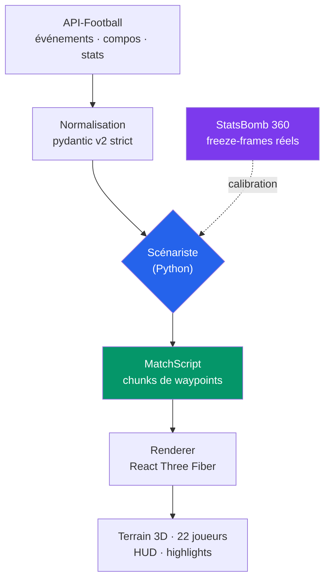

# ⚽ Matchscape

> **Rejouer un match de football en 3D temps réel à partir de simples données d'événements.**
> Pas de données de tracking, pas de caméra : un moteur de scénarisation invente une
> chorégraphie plausible entre chaque événement réel, rendue dans un style low-poly rétro.


---

## Le problème

Les API de football grand public (**API-Football**, TheSportsDB) ne fournissent **aucune
donnée positionnelle** : pas de coordonnées x/y des joueurs ni du ballon. Ces données
existent (Opta, StatsBomb, Second Spectrum) mais coûtent des dizaines de milliers d'euros.

Ce qu'on a réellement, c'est une poignée d'événements horodatés :

```
12'  But    — G. Ramos (passe de D. Doué)   · Normal Goal
23'  Carton — G. Kondogbia                  · Yellow Card · Foul
74'  But    — G. Ramos                      · Penalty
```

**Conséquence : le cœur du projet n'est pas le rendu 3D, c'est le moteur de
scénarisation** — transformer ~15 événements en 90 minutes de football crédible.
C'est une reconstitution vraisemblable, pas une retransmission fidèle.

## Comment ça marche



Le **`MatchScript`** est le format pivot : des chunks contigus de 10-30 s contenant les
waypoints du ballon et de chaque joueur, plus les actions horodatées (passe, tir, tacle).
Il est agnostique du moteur de rendu.

```ts
interface MatchScriptChunk {
  simTimeStart: number;
  simTimeEnd: number;
  phase: 'OPEN_PLAY' | 'SET_PIECE' | 'GOAL_SEQUENCE' | 'RESTART' | 'CELEBRATION';
  ball: Waypoint[];
  players: Record<PlayerId, { waypoints: Waypoint[]; actions: TimedAction[] }>;
}
```

## Le positionnement, calibré sur des données réelles

Plutôt que d'inventer des heuristiques au doigt mouillé, le placement des joueurs est
calibré sur les **freeze-frames StatsBomb 360** (positions réelles de tous les joueurs
visibles à l'instant de chaque événement). L'analyse de **1,2 million de positions**
(`tools/analyze_statsbomb.py`) a donné :

| Mesure | Valeur réelle | Conséquence dans le moteur |
|---|---|---|
| Distance du défenseur le plus proche du ballon | **médiane 4,5 m** | 1-2 défenseurs **pressent** le porteur à ~3,5 m |
| Position des attaquants vs ballon | −12 m à +19 m | bloc réparti autour du ballon, pas en lignes rigides |
| Position des défenseurs vs ballon | côté but (+7 m médian) | ligne défensive maintenue entre ballon et but |

S'y ajoute un comportement **par poste** (issu de la feuille de match : G/D/M/F) croisé
avec la **phase** (avec / sans ballon) : les défenseurs tiennent une ligne et montent à la
relance, les attaquants restent hauts, l'équipe s'étire en attaque et se compacte en défense.

## Ce qui tourne aujourd'hui

- ✅ **Match complet rejouable** — 90 minutes, 317 chunks générés depuis des événements
  au format API-Football
- ✅ **22 joueurs animés** (47 clips : marche, course, sprint, passe, frappe, tacle,
  tête, célébration, jeu de gardien complet)
- ✅ **Menu de highlights cliquable** — saut direct à chaque but, carton, remplacement
- ✅ **Commentaires = données brutes de l'API** (et non du texte généré), pour vérifier
  la correspondance avec le vrai match
- ✅ **Stade 3D** (tribunes, projecteurs, cages) + terrain aux dimensions réglementaires
- ✅ **Gestion VAR** — un but annulé n'est jamais joué
- ✅ **Contrôle de vitesse** ×1 → ×32, HUD score / minute
- ✅ **36 tests** (19 pytest sur le scénariste, 17 vitesse/interpolation côté renderer)

<!-- Captures d'écran : déposer les PNG dans docs/screenshots/ puis référencer ici -->

## Stack

| | |
|---|---|
| **Rendu** | Next.js 14 (App Router), TypeScript strict, React Three Fiber, drei, Zustand |
| **Scénariste** | Python 3.12, pydantic v2 strict, pytest |
| **Pipeline assets** | Blender headless (conversion FBX → GLB multi-clips, nettoyage, retarget de namespace), gltf-transform (Draco + WebP) |
| **Données** | API-Football (événements, compos, stats) · StatsBomb open data (calibration) |

## Démarrage

```bash
# 1. Générer un match jouable depuis des payloads API-Football
cd backend
python -m venv .venv && .venv/Scripts/pip install -r requirements.txt
.venv/Scripts/python -m scenarist.generate \
  --fixture tests/fixtures/fixture_1234567 \
  --out ../frontend/public/demo/match.json

# 2. Lancer le rendu
cd ../frontend
npm install
npm run dev      # http://localhost:3000
```

Tests :

```bash
cd backend  && .venv/Scripts/python -m pytest -q   # scénariste
cd frontend && npm test                            # interpolation, chunks
```

## Structure

```
backend/scenarist/     moteur de scénarisation (le cœur)
  normalize.py         payloads API-Football → modèles internes
  engine.py            événements → chunks MatchScript continus
frontend/
  lib/                 MatchScript, interpolation Hermite, store
  components/three/    terrain, stade, joueurs, ballon, caméra TV
tools/                 pipeline Blender + analyse StatsBomb
docs/animations.md     inventaire des clips d'animation
plan.md                feuille de route et décisions
```

## Feuille de route

- [x] Scénariste couche 1 (heuristiques déterministes, seed reproductible)
- [x] Renderer : match complet, highlights, stade
- [x] Positionnement calibré StatsBomb + comportement par poste
- [ ] Hors-jeu, transitions rapides attaque ↔ défense, largeur des ailiers
- [ ] Ingestion live (polling + WebSocket + rollback VAR)
- [ ] Commentaires enrichis par LLM, replays ralentis
- [ ] Diffusion Twitch (Playwright headless → FFmpeg → RTMP)

## Notes

**Reconstitution simulée.** Les déplacements ne sont pas ceux du vrai match : ils sont
générés pour être plausibles et cohérents avec les événements réels. Les noms de joueurs
sont des données factuelles ; les équipements sont génériques (pas de logo ni de sponsor,
aucun asset issu d'un jeu commercial).

Projet personnel, sans but lucratif.
