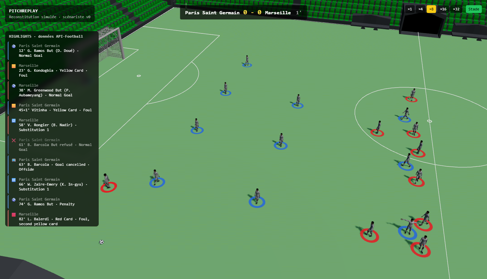
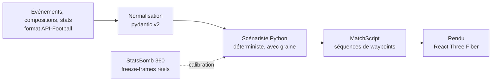

# Matchscape

**11 événements de match deviennent 90 minutes de football rejouable en 3D : 22 joueurs animés, 317 séquences générées, un placement calibré sur 1 267 062 freeze-frames StatsBomb réels.**

Les API de football grand public ne donnent aucune position de joueur. Matchscape invente donc une chorégraphie plausible entre chaque événement. Le cœur du projet n'est pas le rendu 3D, c'est ce moteur de scénarisation.




*Capture réelle du match de démonstration. **Ce match est inventé** : voir plus bas.*

> **C'est une reconstitution, pas une retransmission.** Les déplacements sont générés pour rester plausibles et cohérents avec les événements. Ils ne sont pas ceux d'un vrai match.

## Le problème

Les données de tracking existent (Opta, StatsBomb, Second Spectrum), mais elles sont payantes. API-Football et ses équivalents ne fournissent qu'une poignée d'événements horodatés :

```text
12'  But    · G. Ramos (passe de D. Doué)  · Normal Goal
23'  Carton · G. Kondogbia                 · Yellow Card, Foul
74'  But    · G. Ramos                     · Penalty
```

Il faut en tirer 90 minutes de jeu crédible, sans jamais contredire les faits : un but annulé par la VAR, par exemple, ne doit pas être joué.

## Comment ça marche



Le **MatchScript** est le format pivot : des séquences contiguës de waypoints pour le ballon et chaque joueur, avec les actions horodatées. Il ne dépend d'aucun moteur de rendu.

```ts
interface MatchScriptChunk {
  simTimeStart: number;
  simTimeEnd: number;
  phase: 'OPEN_PLAY' | 'SET_PIECE' | 'GOAL_SEQUENCE' | 'RESTART' | 'CELEBRATION';
  ball: Waypoint[];
  players: Record<PlayerId, { waypoints: Waypoint[]; actions: TimedAction[] }>;
}
```

## Un placement calibré sur des données réelles

Le placement ne repose pas sur des règles au jugé. `tools/analyze_statsbomb.py` mesure où se tiennent vraiment les joueurs sur 1 267 062 freeze-frames [StatsBomb 360](https://github.com/statsbomb/open-data), issus de 400 fichiers de match :

| Mesure, en mètres | Valeur réelle | Effet dans le moteur |
|---|---:|---|
| Défenseur le plus proche du ballon, médiane | 3,9 m | Les 2 joueurs les plus proches pressent le porteur à environ 3,5 m |
| Coéquipiers par rapport au ballon, p10 à p90 | −12 à +19 m | Bloc réparti autour du ballon, pas en lignes rigides |
| Défenseurs par rapport au ballon, médiane | +6 m | Ligne maintenue entre le ballon et le but |

S'y ajoute un comportement par poste (gardien, défenseur, milieu, attaquant) croisé avec la phase de jeu : les défenseurs tiennent leur ligne, les attaquants restent hauts, l'équipe s'étire en attaque et se resserre en défense.

## Ce qui tourne

- **Match complet rejouable** : 90 minutes, 317 séquences, générées de façon reproductible.
- **22 joueurs animés** avec 47 clips : course, passe, frappe, tacle, tête, célébration, jeu de gardien.
- **Menu de highlights** : saut direct à chaque but, carton ou remplacement.
- **Commentaires tirés des données** et non générés, pour vérifier la correspondance avec les événements.
- **Gestion de la VAR** : un but annulé n'est jamais joué.
- **Stade 3D**, terrain aux dimensions réglementaires, vitesse de ×1 à ×32.
- **36 tests** : 19 sur le scénariste, 17 sur l'interpolation et les séquences du rendu.

## Démarrage

Le match de démonstration est déjà dans le dépôt, le rendu suffit donc pour le voir :

```bash
cd frontend
npm install
npm run dev      # http://localhost:3000
```

Pour le régénérer depuis les événements :

```bash
cd backend
python -m venv .venv
.venv/Scripts/pip install -r requirements.txt
.venv/Scripts/python -m scenarist.generate --fixture tests/fixtures/fixture_1234567 --out ../frontend/public/demo/match.json
```

Tests :

```bash
cd backend && .venv/Scripts/python -m pytest -q
```

```bash
cd frontend && npm test
```

Le rendu 3D demande une carte graphique pour rester fluide.

## Structure

```
backend/scenarist/     le moteur de scénarisation, cœur du projet
  normalize.py         format API-Football vers modèles internes
  engine.py            événements vers séquences MatchScript
frontend/
  lib/                 MatchScript, interpolation de Hermite, store
  components/three/    terrain, stade, joueurs, ballon, caméra TV
tools/                 pipeline Blender et analyse StatsBomb
docs/animations.md     inventaire des clips d'animation
plan.md                feuille de route et décisions
```

Pipeline des modèles : conversion FBX vers GLB multi-clips avec Blender en ligne de commande, à partir d'animations Mixamo.

## Limites

- **Le match de démonstration est inventé.** C'est un PSG 3-1 OM fictif, au format exact d'API-Football, conçu pour couvrir tous les cas du scénariste (penalty, VAR, rouge, remplacements). Les noms sont ceux de vrais joueurs, mais les événements n'ont pas eu lieu. Le libellé « données API-Football » de l'interface désigne le format, et le dépôt ne contient pas d'enregistrement d'un vrai match.
- **Réalisme non mesuré.** La calibration s'appuie sur des données réelles, mais je n'ai pas mesuré à quel point le résultat ressemble à du vrai football.
- **Pas encore géré** : hors-jeu, transitions rapides, largeur des ailiers.
- **Pas de direct** : l'ingestion en temps réel et la diffusion restent à faire.

## Suite

- Rejouer de vrais matchs depuis l'API.
- Hors-jeu, transitions et largeur des ailiers.
- Ingestion en direct, avec correction en cas de décision VAR.
- Commentaires enrichis et ralentis.

## Crédits

Calibration : [StatsBomb Open Data](https://github.com/statsbomb/open-data). Animations : [Mixamo](https://www.mixamo.com). Équipements génériques, sans logo ni sponsor.

Projet personnel, sans but lucratif.
